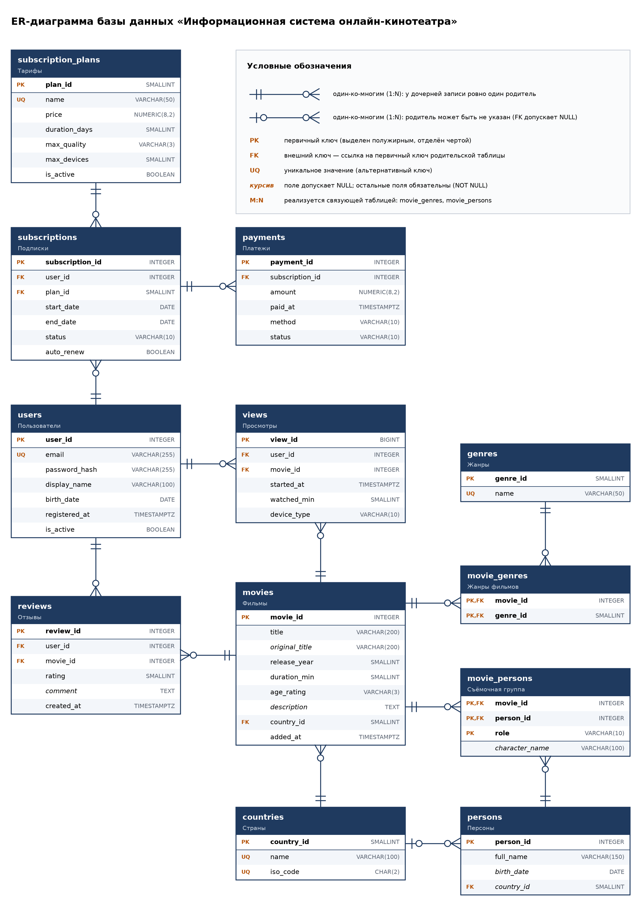

# База данных онлайн-кинотеатра

Учебная практика по модулю ПМ.01 «Разработка, администрирование и защита баз данных».

- **Тема № 12:** Проектирование БД «Информационная система онлайн-кинотеатра»
- **Студент:** Бердюгин Евгений, группа 9/4-РПО-2023/1
- **СУБД:** PostgreSQL

## Ход практики

| Контрольная точка | Содержание | Состояние |
|---|---|---|
| КТ 1. Проектирование и концептуальная модель БД | Анализ требований, ER-диаграмма, нормализация до 3НФ | выполнена |
| КТ 2. Реализация, наполнение и создание объектов БД | DDL, тестовые данные, запросы, процедура, триггер, представление | впереди |
| КТ 3. Администрирование, защита и итоговый отчёт | Роли и права, резервное копирование, отчёт | впереди |

## КТ 1 — что сдаётся

| Требование | Где находится |
|---|---|
| ER-диаграмма (PNG / PDF) | [er/er_diagram.png](er/er_diagram.png), [er/er_diagram.pdf](er/er_diagram.pdf) |
| Анализ требований, описание структуры, типы данных, обоснование 3НФ | [report/](report/) — раздел 1 отчёта, docx и pdf |
| Дневник практики | [Google Документ](https://docs.google.com/document/d/1jAh5NQbXFcoZvZOp9DPmTbrsXT71Su6VpN0C5JQwpJg/), копия в [diary/](diary/) |

## Модель данных

12 таблиц, 13 связей «один-ко-многим», две связующие таблицы для связей «многие-ко-многим».



| Группа | Таблицы |
|---|---|
| Каталог | `movies`, `genres`, `persons`, `countries`, `movie_genres`, `movie_persons` |
| Зрители и оплата | `users`, `subscription_plans`, `subscriptions`, `payments` |
| Активность зрителей | `views`, `reviews` |

## Структура репозитория

```
er/          ER-диаграмма в PNG и PDF
report/      отчёт по практике (docx, pdf)
diary/       дневник практики
materials/   задание: темы, контрольные точки, регламент защиты, шаблон отчёта
```
